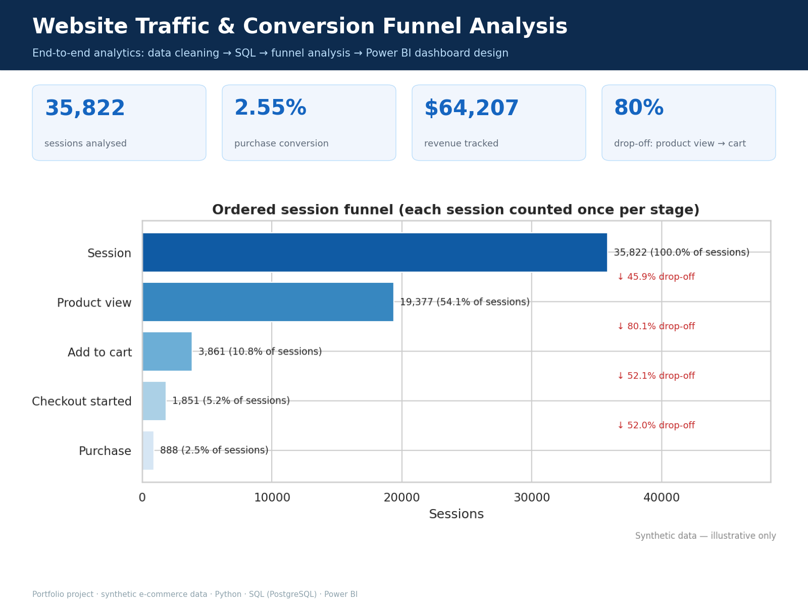

# Website Traffic & Conversion Funnel Analysis

**An end-to-end e-commerce analytics project using Python, PostgreSQL, SQL, Power BI, and DAX to transform raw website tracking data into actionable business insights.**

<p align="center">
  
</p>

<p align="center">
  
  
  
  
  
  
</p>

## Project Overview

This project analyzes website traffic, marketing channel performance, revenue generation, and e-commerce conversion funnels. It demonstrates how raw, inconsistent tracking data can be cleaned, modeled, analyzed, validated, and transformed into interactive Power BI dashboards.

The objective is to help an e-commerce business understand where visitors come from, which marketing channels generate revenue, where customers abandon the purchase journey, and which improvements could increase conversions.

**Dataset:** Synthetic e-commerce analytics data generated using a reproducible Python script. The dataset intentionally includes realistic tracking and data-quality problems. All reported results represent this demonstration dataset, not an actual company's performance.

## Power BI Dashboard

The report is designed around four analytical pages, providing both executive-level KPIs and detailed investigation tools.

### 1. Executive Traffic Overview

Provides a high-level view of website traffic, revenue, purchasing sessions, and conversion performance.

**Key features**
- Total revenue and total sessions
- Revenue distribution by marketing channel
- Session distribution by acquisition channel
- Monthly purchase conversion trends
- Revenue per session and purchasing session KPIs
- Interactive date and channel filters

<p align="center">
  
</p>

### 2. Marketing Channel Performance

Compares the commercial value of different traffic sources and identifies channels that may require optimization.

**Key features**
- Revenue and session share by channel
- Purchase conversion rate by acquisition channel
- Revenue per session and average order value
- Channel performance comparison
- Campaign-level analysis
- Interactive date, channel, and campaign slicers

<p align="center">
  
</p>

### 3. Conversion Funnel Analysis

Examines the customer journey from the initial session to a completed purchase and identifies stages where visitors leave.

**Funnel stages**
1. Session start
2. Product view
3. Add to cart
4. Begin checkout
5. Purchase

**Key features**
- Sessions reaching each funnel stage
- Stage-to-stage conversion rates
- Drop-off rates between consecutive stages
- Largest funnel loss identification
- Interactive date, channel, and device filters

<p align="center">
  
</p>

### 4. Device & Landing Page Analysis

Investigates how device type and landing page performance relate to visitor engagement and purchasing behavior.

**Key features**
- Mobile versus desktop conversion analysis
- Checkout completion comparisons
- Channel and device performance matrix
- Landing page performance ranking
- Pages flagged for further investigation
- Drill-down analysis by acquisition source and device

<p align="center">
  
</p>

> **Dashboard assets:** Save your actual screenshots using the filenames shown above. If a page is not yet complete, omit its image until the final screenshot is available. The images above are intended as repository paths, not externally hosted screenshots.

## Business Problem

An online store receives traffic from multiple marketing channels but lacks a reliable, unified view of traffic quality and conversion performance.

The business needs to answer questions such as:

- Which marketing channels generate the most sessions and revenue?
- Which channels convert visitors into purchasing customers most efficiently?
- At which stage do visitors abandon the purchase journey?
- Does mobile checkout perform differently from desktop checkout?
- Which campaigns and landing pages deserve further investigation?
- What actions could improve revenue and purchase conversion?

This project addresses these questions using reproducible data preparation, SQL analysis, analytical data modeling, and interactive Power BI reporting.

## Key Findings

The following findings are based on the project's documented synthetic dataset and analytical results.

| Business question | Finding |
|---|---|
| Largest traffic source | Organic Search: 11,480 sessions (approximately 32%) |
| Strong conversion channels | Email: 6.04%; Paid Search: 3.98% |
| Site-wide conversion benchmark | 2.55% |
| Channel efficiency concern | Paid Social generates a disproportionately low share of revenue relative to its traffic |
| Largest funnel drop-off | Product View → Add to Cart: approximately 80% |
| Device performance concern | Mobile checkout completion: 37%, compared with 58% on desktop |
| Landing pages to investigate | `/collections/sale` and `/campaign/spring-sale` |

These metrics are synthetic demonstration results and should be reconciled against the final Power BI report before being presented as verified dashboard KPIs.

## Business Recommendations

### 1. Improve the Mobile Checkout Experience

Investigate the mobile checkout journey, including form usability, page speed, payment errors, and unnecessary checkout steps.

**Suggested success metrics:** mobile checkout completion rate, checkout abandonment rate, and completed orders.

### 2. Optimize Paid Social Campaigns

Investigate the gap between Paid Social traffic and revenue. Review audience targeting, campaign messaging, landing-page relevance, and product selection before increasing or reducing spending.

**Suggested success metrics:** purchase conversion rate, revenue per session, cost per acquisition, and return on ad spend when advertising cost data becomes available.

### 3. Strengthen Abandoned-Cart Recovery

Evaluate targeted email reminders for visitors who add products to their carts but do not complete a purchase.

**Suggested success metrics:** recovered orders, email-attributed revenue, and conversion rate among eligible abandoned-cart sessions.

### 4. Investigate Underperforming Landing Pages

Review the identified commercial landing pages and blog content for traffic quality, relevance, engagement, and progression into product views and purchases.

**Suggested success metrics:** product-view rate, add-to-cart rate, purchase conversion rate, and revenue per session.

> These recommendations are hypotheses for further investigation and experimentation. The potential impact should be validated using controlled tests and actual business data.

## Technical Skills Demonstrated

| Area | Skills and implementation |
|---|---|
| Data analysis | Exploratory data analysis, KPI analysis, trend analysis, funnel analysis |
| Python | pandas, data cleaning, data validation, reproducible processing |
| SQL | PostgreSQL, CTEs, window functions, aggregation, constraints, validation queries |
| Power BI | Interactive dashboards, report design, slicers, drill-down analysis |
| DAX | Measures, conversion rates, revenue metrics, date-aware calculations |
| Data modeling | Star schema, fact tables, dimension tables, relationship design |
| Data quality | Duplicate detection, missing-value handling, timestamp validation, reconciliation |
| Testing | pytest, SQL assertions, cross-tool metric validation |
| Business communication | Executive summaries, actionable recommendations, documented limitations |

## Data Pipeline & Architecture

The project follows a reproducible end-to-end analytics workflow.

```text
Synthetic Raw Tracking Data
          |
          v
Python Data Quality Assessment
          |
          v
Data Cleaning & Transformation
          |
          v
Star Schema CSV Exports
          |
          +-----------------------+
          |                       |
          v                       v
   PostgreSQL / SQL          Power BI
   Analytical Queries        Data Modeling
   Funnel Analysis           DAX Measures
          |                       |
          +-----------+-----------+
                      |
                      v
           Metric Reconciliation
                      |
                      v
         Dashboard & Business Insights
                      |
                      v
          Recommendations and Reports
```

### Pipeline stages

1. **Generate:** create reproducible raw tracking data using a fixed random seed.
2. **Profile:** identify data-quality issues in raw records.
3. **Clean:** standardize fields, handle duplicates, validate records, and prepare analytical tables.
4. **Model:** create fact and dimension tables for reporting.
5. **Analyze:** calculate traffic, revenue, channel, device, and funnel metrics using Python and SQL.
6. **Visualize:** develop interactive Power BI report pages.
7. **Validate:** test business rules and reconcile headline metrics across analytical implementations.
8. **Communicate:** document findings, recommendations, and analytical limitations.

## Data Model

The analytical model uses a star-schema design to support consistent filtering and aggregation.

### Fact tables

- **FactSessions:** one row per session, with session-level dimensions and attributes.
- **FactEvents:** one row per tracked event, preserving event timestamps and event details.
- **FactTransactions:** one row per valid transaction, with transaction-level revenue information.

### Dimension tables

- **DimDate:** date attributes for time-based analysis.
- **DimTrafficSource:** marketing channel and traffic-source attributes.
- **DimDevice:** device categories.
- **DimLandingPage:** landing-page attributes.
- **DimFunnelStage:** helper dimension for funnel-stage reporting.

The model is designed so dimensions filter the relevant fact tables directly. Fact tables should not be joined to each other in a way that multiplies rows or inflates revenue.

Session date is the primary active date relationship. Transaction date can use an inactive relationship activated by `USERELATIONSHIP` where required.

Documentation: `powerbi/data_model.md` and `data/data_dictionary.md`.

## KPI Definitions

| KPI | Definition |
|---|---|
| Total Sessions | Count of session records, using the session-level fact table |
| Purchasing Sessions | Distinct sessions containing at least one valid transaction |
| Purchase Conversion Rate | Purchasing sessions ÷ total sessions |
| Total Revenue | Sum of transaction revenue according to the documented revenue policy |
| Net Revenue | Revenue adjusted for refunds, where refund data is available |
| Average Order Value | Revenue ÷ number of qualifying transactions |
| Revenue per Session | Revenue ÷ total sessions |
| Funnel Conversion Rate | Sessions reaching the next stage ÷ sessions reaching the preceding stage |
| Funnel Drop-off Rate | 1 − funnel conversion rate between consecutive stages |
| Channel Revenue Share | Revenue attributed to a channel ÷ total attributed revenue |
| Channel Session Share | Sessions attributed to a channel ÷ total sessions |

Funnel calculations use session-level reach and timestamp ordering to avoid counting repeated events as additional converted sessions. Funnel purchases and purchasing sessions may differ because they represent different units of analysis; the difference should be explained in the validation documentation.

## Repository Structure

```text
Website-Traffic-Conversion-Analysis/
├── data/
│   ├── raw/
│   ├── processed/
│   │   └── model/
│   └── data_dictionary.md
├── notebooks/
│   ├── 01_data_quality_assessment.ipynb
│   ├── 02_exploratory_data_analysis.ipynb
│   └── 03_conversion_funnel_analysis.ipynb
├── python/
│   ├── generate_sample_data.py
│   ├── data_quality.py
│   ├── clean_data.py
│   ├── analysis.py
│   └── reconcile.py
├── sql/
│   ├── 01_create_tables.sql
│   ├── 01b_load_data.sql
│   ├── 02_data_quality_checks.sql
│   ├── 03_channel_analysis.sql
│   ├── 05_conversion_funnel.sql
│   └── 08_validation_checks.sql
├── powerbi/
│   ├── data_model.md
│   ├── dax_measures.md
│   ├── dashboard_design.md
│   ├── power_query_guide.md
│   ├── theme.json
│   └── wireframes/
├── reports/
│   ├── executive_summary.md
│   ├── business_recommendations.md
│   ├── limitations.md
│   └── figures/
├── portfolio/
│   ├── 01_cover.png
│   ├── 02_mobile_checkout_gap.png
│   └── 03_channel_efficiency.png
├── screenshots/
│   ├── 01_executive_traffic_overview.png
│   ├── 02_marketing_channel_performance.png
│   ├── 03_conversion_funnel.png
│   └── 04_device_landing_page_analysis.png
├── tests/
├── requirements.txt
├── run_pipeline.sh
├── .env.example
├── LICENSE
└── README.md
```

*The tree is representative of the intended project organization. Keep only files and directories that actually exist in your repository.*

## How to Run the Project

### Prerequisites

- Python 3.11 or newer
- PostgreSQL 13 or newer (optional for Python-only analysis)
- Power BI Desktop on Windows (for opening or rebuilding the report)
- Git

### 1. Clone the repository

```bash
git clone https://github.com/zak2721/Website-Traffic-Conversion-Analysis.git
cd Website-Traffic-Conversion-Analysis
```

Replace the repository URL with your actual GitHub URL if the repository has a different name.

### 2. Create a virtual environment

**Windows PowerShell**

```powershell
python -m venv .venv
.\.venv\Scripts\Activate.ps1
pip install -r requirements.txt
```

**Linux or macOS**

```bash
python -m venv .venv
source .venv/bin/activate
pip install -r requirements.txt
```

### 3. Generate and clean the data

```bash
python python/generate_sample_data.py
python python/data_quality.py --stage raw
python python/clean_data.py
python python/data_quality.py --stage processed
```

### 4. Run the analysis

```bash
python python/analysis.py
```

### 5. Load the data into PostgreSQL (optional)

Create a database named `webanalytics`, configure your PostgreSQL connection, and run the SQL scripts in the documented order.

For example:

```bash
psql -d webanalytics -f sql/01_create_tables.sql
psql -d webanalytics -f sql/01b_load_data.sql
psql -d webanalytics -f sql/05_conversion_funnel.sql
psql -d webanalytics -f sql/08_validation_checks.sql
```

Check the individual scripts and project configuration for connection requirements and execution dependencies. If CSV loading uses `\copy`, run the commands through `psql`.

### 6. Run tests and reconciliation

```bash
pytest -v
python python/reconcile.py
```

SQL validation requires a configured database. Tests that depend on PostgreSQL may skip when the database is unavailable.

### 7. Build or open the Power BI report

1. Open Power BI Desktop.
2. Import the processed model CSV files or connect to PostgreSQL.
3. Apply the transformations described in `powerbi/power_query_guide.md`.
4. Configure relationships according to `powerbi/data_model.md`.
5. Create or import the documented DAX measures.
6. Build the report pages using `powerbi/dashboard_design.md`.
7. Validate headline metrics against the Python and SQL outputs.

**Important:** A dashboard specification and screenshots are not the same as a finished `.pbix` file. Include the actual Power BI report in the repository only when it exists and is ready to share.

## Validation & Testing

The project includes automated checks intended to protect data integrity and analytical accuracy.

| Validation area | Purpose |
|---|---|
| Python tests | Validate schema, keys, data rules, timestamps, and funnel logic |
| SQL assertions | Verify analytical rules and expected results |
| Data-quality checks | Compare raw and processed data quality |
| Reconciliation | Compare headline metrics across Python, SQL, and documented DAX definitions |
| Fan-out prevention | Check that relationships and joins do not inflate session or revenue totals |
| Reproducibility | Regenerate the dataset using a fixed seed |

The project validation results documented during development are **28/28 Python tests passed** and **20/20 SQL assertions passed**. These should be reported as current only after rerunning the tests against the final committed version.

## Limitations

- The dataset is synthetic and does not represent an actual business.
- The analysis covers a six-month period.
- Attribution uses a simplified last-click session approach.
- Advertising spend is not included, so ROAS and cost per acquisition cannot be calculated reliably.
- Observational differences do not prove causation.
- Dashboard results must be reconciled with the latest dataset and measures before final publication.
- A Power BI `.pbix` file should not be described as included unless it is present in the repository.

## Future Improvements

- Analyze the public GA4 e-commerce sample through the appropriate BigQuery connector.
- Add advertising spend and campaign cost data.
- Develop multi-session attribution analysis.
- Add A/B-test reporting for mobile checkout improvements.
- Automate data refresh and reporting workflows.
- Publish a validated Power BI report with documented measures.
- Add further device, landing-page, and customer-segment analysis.

## License

This project is released under the MIT License. See `LICENSE` for details.

## Author

**Zekarias Adefris**

Data Analyst | Power BI Developer | SQL & Python

- **GitHub:** [github.com/zak2721](https://github.com/zak2721/)
- **Location:** Addis Ababa, Ethiopia

---

*This portfolio project demonstrates practical data analytics, business intelligence, data quality, and analytical communication skills through a reproducible end-to-end workflow.*
