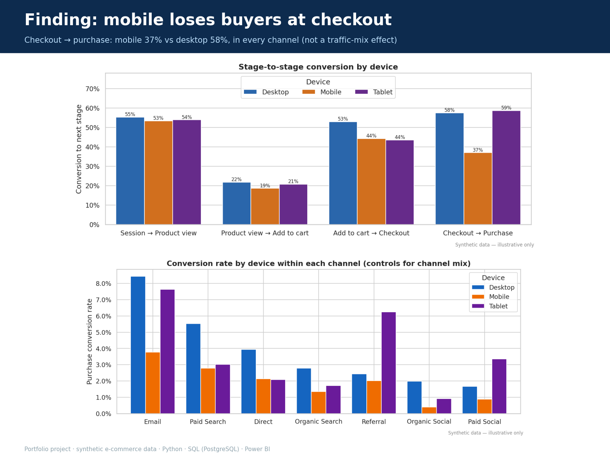
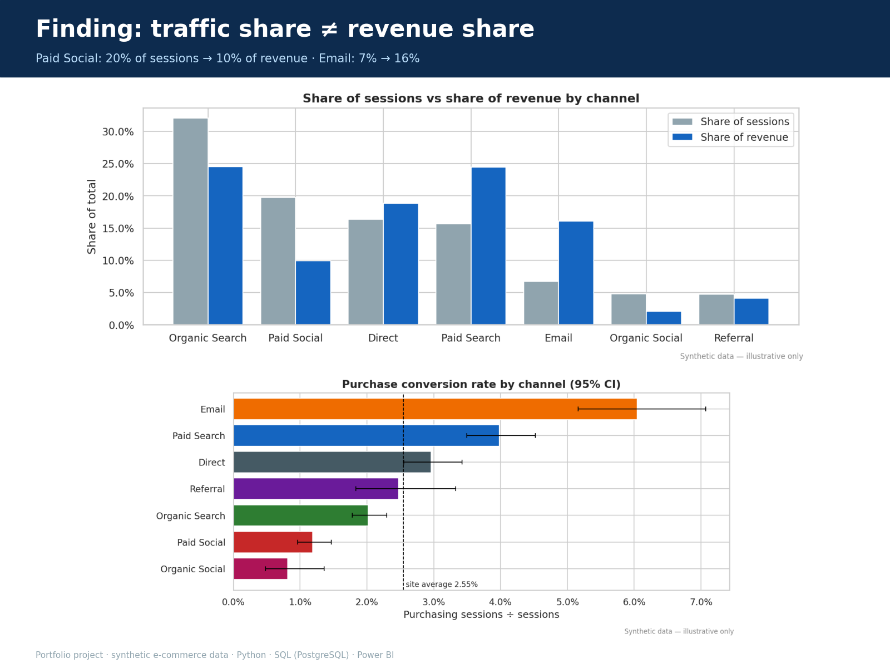

# Website Traffic & Conversion Funnel Analysis

**End-to-end e-commerce analytics: messy tracking data → cleaned star schema → SQL & Python analysis → Power BI dashboard design → business recommendations.**

)

> **Data disclosure:** this project uses a **synthetic** dataset generated by the included script, because the
> standard public GA4 e-commerce sample is only available in BigQuery. The data is realistic in structure and
> deliberately contains real-world tracking defects. Results demonstrate the analytical method; they are **not**
> the performance of any real company.

---

## The business problem

An online store receives traffic from seven marketing channels but cannot answer basic questions:
which channels bring *valuable* visitors, where shoppers abandon the purchase journey, whether mobile under-performs,
and which landing pages waste traffic. This project answers each question with verified numbers and turns them into
prioritised, testable recommendations.

## Key findings

| Question | Answer (Jan–Jun 2025) |
|---|---|
| Biggest traffic source | Organic Search: 11,480 sessions (32%) |
| Most efficient channels | Email 6.04% conversion · Paid Search 3.98% (vs 2.55% site average) |
| Least efficient channel | Paid Social: 20% of sessions but only 10% of revenue |
| Largest funnel drop-off | Product view → add to cart: **80%** of product viewers leave |
| Mobile vs desktop | Mobile checkout completion **37% vs 58%** on desktop, in *every* channel |
| Pages to investigate | `/collections/sale`, `/campaign/spring-sale` (commercial); 2 blog posts (content) |

| Mobile loses buyers at checkout | Traffic share ≠ revenue share |
|---|---|
|  |  |

**Top recommendations:** (1) simplify the mobile checkout; the upper-bound opportunity is ~178 orders / ~$12k over six
months. (2) Re-target Paid Social and stop sending it to the 0.6%-converting campaign page. (3) Scale abandoned-cart
email (7.3% conversion). Full detail: [`reports/executive_summary.md`](reports/executive_summary.md) ·
[`reports/business_recommendations.md`](reports/business_recommendations.md).

---

## What this project demonstrates

| Skill | Where to look |
|---|---|
| Data cleaning & QA (pandas) | [`python/clean_data.py`](python/clean_data.py), [`notebooks/01`](notebooks/01_data_quality_assessment.ipynb): 18 defect types handled; every decision logged with rows affected |
| SQL (PostgreSQL): CTEs, window functions, constraints | [`sql/`](sql): 10 scripts; funnel built from raw events with timestamp ordering |
| Funnel analytics done correctly | Session-based, **ordered** funnel; counts once per stage; reconciled with transaction KPIs |
| Statistics for business | 95% confidence intervals so small samples aren't over-interpreted |
| Power BI data modelling & DAX | [`powerbi/`](powerbi): star schema, 40+ documented measures with expected values, 4-page spec |
| Testing & validation | 28 pytest tests + 20 SQL assertions; Python = SQL = DAX definitions to the cent |
| Business communication | Executive summary, recommendations with KPIs, explicit limitations |

## Architecture

```
data/raw/*.csv  ──► python/clean_data.py ──► data/processed/model/*.csv (star schema)
 (messy exports)     standardise · dedupe ·        │                │
                     quarantine · funnel flags     ▼                ▼
                                            PostgreSQL (sql/)   Power BI (powerbi/)
                                                   │                │
                     python/analysis.py ◄──────────┴── reconcile.py ┘
                     notebooks · charts · reports        tests/
```

## Data model (star schema)

* **FactSessions** (1 row per session) · **FactEvents** (1 per event) · **FactTransactions** (1 per valid order)
* **DimDate** · **DimTrafficSource** · **DimDevice** · **DimLandingPage** · **DimFunnelStage** (disconnected helper)
* Every fact carries the session's dimension keys, so dimensions filter each fact directly and facts are never joined
  to each other. This prevents revenue inflation. Session date is the active date relationship; transaction date is inactive (`USERELATIONSHIP`).

Details: [`powerbi/data_model.md`](powerbi/data_model.md) · [`data/data_dictionary.md`](data/data_dictionary.md)

## KPI definitions

| KPI | Definition |
|---|---|
| Sessions | Rows in FactSessions (never event counts) |
| Purchasing sessions | Distinct sessions with ≥1 valid transaction |
| Purchase conversion rate | Purchasing sessions ÷ sessions |
| Revenue | Sum of valid transactions (completed + refunded); *Net revenue* excludes refunds |
| AOV / Revenue per session | Revenue ÷ transactions / Revenue ÷ sessions |
| Funnel stage | Session reaches stage *n* only if the stage event occurs **at or after** stage *n-1* |
| Drop-off | 1 − (sessions at next stage ÷ sessions at this stage) |

The funnel *Purchase* stage (888) and *Purchasing Sessions* (913) differ by design; the gap is fully explained in
[notebook 03](notebooks/03_conversion_funnel_analysis.ipynb) §3.

## Dashboard pages (Power BI)

1. **Executive Traffic Overview:** KPI cards with period growth, trend, sessions/revenue by channel
2. **Marketing Channel Performance:** scorecard, efficiency scatter, campaign drill-down
3. **Conversion Funnel:** stage bars with drop-off, largest-loss callouts, device funnel matrix
4. **Device & Landing Pages:** device comparison, channel × device matrix, sortable page table with investigation flag

Specs: [`powerbi/dashboard_design.md`](powerbi/dashboard_design.md) · Measures: [`powerbi/dax_measures.md`](powerbi/dax_measures.md) ·
Import steps: [`powerbi/power_query_guide.md`](powerbi/power_query_guide.md) · Layout sketches (illustrative):
[`powerbi/wireframes/`](powerbi/wireframes) · Report screenshots: [`screenshots/`](screenshots)

---

## How to run it

**Requirements:** Python 3.11+; optionally PostgreSQL 13+ (`psql` on PATH) and Power BI Desktop (Windows).

```bash
git clone <repo-url> && cd Website-Traffic-Conversion-Analysis
python -m venv .venv && source .venv/bin/activate      # Windows: .venv\Scripts\activate
pip install -r requirements.txt

# Full pipeline (generate → clean → analyse → PostgreSQL → notebooks → tests → reconcile)
export PGDATABASE=webanalytics                          # plus PGHOST/PGUSER as needed (see .env.example)
createdb webanalytics                                   # once
./run_pipeline.sh                                       # or: SKIP_SQL=1 ./run_pipeline.sh
```

<details><summary>Individual steps (also work on Windows PowerShell)</summary>

```bash
python python/generate_sample_data.py            # 1. synthetic raw data  (data/raw)
python python/data_quality.py --stage raw        # 2. raw data-quality profile
python python/clean_data.py                      # 3. clean + build star schema (data/processed)
python python/data_quality.py --stage processed  #    post-cleaning profile
python python/analysis.py                        # 4. metrics (reports/metrics) + charts (reports/figures)
psql -f sql/01_create_tables.sql                 # 5. PostgreSQL schema   (run from repo root)
psql -f sql/01b_load_data.sql                    #    load CSVs with \copy
psql -f sql/05_conversion_funnel.sql             #    any analysis script 02–08
jupyter lab notebooks/                           # 6. explore the notebooks
pytest -v                                        # 7. tests (SQL test auto-skips without a database)
python python/reconcile.py                       # 8. Python vs SQL vs DAX-definition reconciliation
```
</details>

The data is generated from a fixed seed, so every run reproduces the numbers in this README exactly.
The generated CSVs are also committed, so the Power BI model can be built without running Python.

## Validation status

| Check | Result |
|---|---|
| pytest (schema, keys, referential integrity, timestamps, revenue rules, funnel logic, zero/empty handling, no fan-out) | **28 / 28 passed** |
| SQL assertions (`sql/08_validation_checks.sql`) | **20 / 20 PASS** |
| Python vs SQL vs DAX definitions (8 headline metrics) | **All match**: [`reconciliation.md`](reports/metrics/reconciliation.md) |
| Independent SQL-only cleaning vs Python cleaning | Identical sessions, transactions, revenue and channel counts |
| Cleaning vs generator ground truth | Exact match on all three tables |

## Repository structure

```
├── data/            raw/ (untouched exports) · processed/ (clean + model/ star schema) · data_dictionary.md
├── notebooks/       01 data quality · 02 EDA · 03 funnel analysis (executed, outputs saved)
├── python/          generate · data_quality · clean_data · metrics · analysis · reconcile · build_* helpers
├── sql/             01 schema · 01b load · 02 DQ checks · 03–07 analyses · 08 validation
├── powerbi/         data_model · power_query_guide · dax_measures · dashboard_design · theme.json · wireframes/
├── reports/         executive_summary · business_recommendations · limitations · figures/ · metrics/
├── portfolio/       showcase images built from the real analysis outputs
├── tests/           pytest suite
└── screenshots/     Power BI report screenshots (added after building the report)
```

## Limitations

Synthetic data with designed-in effects; last-click session attribution; no ad-spend data (so no ROAS); six months only;
observational comparisons (not causal). The Power BI report is specified but not included as a `.pbix`. Full list:
[`reports/limitations.md`](reports/limitations.md).

## Future improvements

* Run the same pipeline on the real GA4 BigQuery sample (`ga4_obfuscated_sample_ecommerce`) via the BigQuery connector
* Add ad-spend data for cost per purchase and ROAS by channel
* Multi-session / data-driven attribution to value blog and social traffic fairly
* A/B-test readout template for the mobile checkout experiment
* Scheduled refresh through PostgreSQL + Power BI Service gateway

## License

MIT, see [LICENSE](LICENSE).
