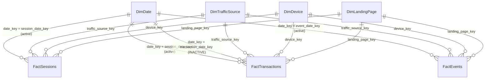

# Power BI Data Model

Star schema built from the CSVs in `data/processed/model/` (produced by `python/clean_data.py`).
Import mode. All files are UTF-8, comma-delimited, with a header row.

> The model, measures and pages are specified here for implementation in **Power BI Desktop**. No `.pbix`
> is included: Power BI Desktop cannot be automated in the build environment. Building the report from
> these specs takes roughly 2–3 hours (see `power_query_guide.md` → `dax_measures.md` → `dashboard_design.md`).

## 1. Model diagram

`DimFunnelStage` is a **disconnected** helper table (no relationships). It provides the stage axis for funnel visuals.

## 2. Tables and grain

| Table | Source file | Grain | Primary key | Rows (seed 42) |
|---|---|---|---|---:|
| FactSessions | fact_sessions.csv | one row per session | session_id | 35,822 |
| FactEvents | fact_events.csv | one row per tracked event | event_id | 160,474 |
| FactTransactions | fact_transactions.csv | one row per valid transaction | transaction_id | 913 |
| DimDate | dim_date.csv | one row per calendar day | date_key (yyyymmdd) | 182 |
| DimTrafficSource | dim_traffic_source.csv | one row per source / medium / campaign | traffic_source_key | 17 |
| DimDevice | dim_device.csv | one row per device category | device_key | 4 |
| DimLandingPage | dim_landing_page.csv | one row per normalised landing page | landing_page_key | 10 |
| DimFunnelStage | dim_funnel_stage.csv | one row per funnel stage | stage_order | 5 |

### Why three fact tables, and why they are never joined to each other

* Sessions, events and transactions have **different grains**. A direct relationship between `FactSessions` and
  `FactEvents` (one-to-many) would make any session-level sum repeat once per event, and a bidirectional
  fact-to-fact link creates ambiguous filter paths.
* Instead, `python/clean_data.py` copies the session's dimension keys (`traffic_source_key`, `device_key`,
  `landing_page_key`, `session_date_key`) onto every event and transaction. Each dimension then filters each
  fact **directly**. Slicing revenue by channel never passes through the sessions table, so revenue cannot inflate.
* Funnel stage membership is pre-computed per session (`reached_*` flags on `FactSessions`), so funnel measures
  are simple `SUM`s at session grain. They are not `DISTINCTCOUNT`s over the 160k-row event table.
  `sql/08_validation_checks.sql` and `tests/test_data_quality.py` prove the flags equal a from-scratch
  recomputation from events.

## 3. Relationships

| From (many) | To (one) | Cardinality | Cross-filter | Active | Purpose |
|---|---|---|---|---|---|
| FactSessions[session_date_key] | DimDate[date_key] | *:1 | Single | ✅ | Sessions by date |
| FactTransactions[session_date_key] | DimDate[date_key] | *:1 | Single | ✅ | Revenue attributed to the session's date (consistent with conversion rate) |
| FactTransactions[transaction_date_key] | DimDate[date_key] | *:1 | Single | ❌ inactive | Finance view: revenue on the day the order was placed (`USERELATIONSHIP`) |
| FactEvents[event_date_key] | DimDate[date_key] | *:1 | Single | ✅ | Event activity by date |
| Fact*[traffic_source_key] | DimTrafficSource[traffic_source_key] | *:1 | Single | ✅ | Channel / source / campaign |
| Fact*[device_key] | DimDevice[device_key] | *:1 | Single | ✅ | Device |
| Fact*[landing_page_key] | DimLandingPage[landing_page_key] | *:1 | Single | ✅ | Landing page |

**Why session date is the active date for transactions:** *Purchase Conversion Rate* = purchasing sessions ÷ sessions.
Both sides must be filtered by the same date, otherwise a session on 31 Jan that purchases after midnight would count
in January's denominator and February's numerator. The inactive transaction-date relationship is available for
finance reconciliation through the measure `[Revenue (Transaction Date)]`.

**No bidirectional filters.** None are needed. Avoiding them prevents ambiguity and slicer cross-filtering surprises.

## 4. Date table

1. Select `DimDate` → **Table tools → Mark as date table** → date column `date`.
2. Sort `month_name` by `month_number` and `day_of_week` by `day_of_week_number` (**Column tools → Sort by column**).
3. Hierarchy: `year → quarter → year_month → date`.
4. The table covers every day from the first session to the last event (contiguous; tested). If you load a new
   period, regenerate `dim_date.csv` with `clean_data.py` or replace it with a DAX `CALENDAR()` table spanning the facts.

## 5. Columns: data types and formatting

| Table | Column | Type | Format / notes |
|---|---|---|---|
| FactSessions | session_id, visitor_id, country | Text | |
| | session_start | Date/time | `yyyy-mm-dd hh:nn` |
| | *_key | Whole number | **Hide** in report view |
| | engaged_session, page_views, reached_*, has_*_event, purchase_sequence_violation, is_purchasing_session | Whole number | Hide raw flags; expose via measures |
| FactEvents | event_timestamp | Date/time | |
| | event_name, page_path, product_id | Text | |
| FactTransactions | revenue | Fixed decimal (Currency) | `$#,0.00` |
| | transaction_timestamp | Date/time | |
| | transaction_status, currency | Text | |
| | is_refunded | Whole number | |
| DimDate | date, month_start, week_start | Date | `dd mmm yyyy` |
| DimTrafficSource | channel_group, traffic_source, marketing_medium, campaign, source_medium | Text | Hierarchy: channel_group → source_medium → campaign |
| DimDevice | device_label | Text | Sort by `device_sort` |
| DimLandingPage | landing_page, page_type | Text | |

Set **Summarize by = Don't summarize** on every key and flag column so nobody accidentally drags a raw `SUM` of a key
onto a visual. All business numbers come from the measures in `dax_measures.md`, stored in a dedicated
`_Measures` table (Enter data → one dummy column → hide the column).

## 6. Recommended slicers

| Slicer | Field | Style | Pages |
|---|---|---|---|
| Date range | DimDate[date] | Between (with relative-date option) | All (synced) |
| Channel | DimTrafficSource[channel_group] | Dropdown, multi-select | All (synced) |
| Device | DimDevice[device_label] | Tiles | 3, 4 (synced) |
| Campaign | DimTrafficSource[campaign] | Dropdown | 2 |
| Page type | DimLandingPage[page_type] | Dropdown | 4 |

Use **View → Sync slicers** so the date and channel selections persist across pages. Consider a default filter
`DimDevice[device_category] <> "unknown"` on device-comparison visuals only (107 sessions; documented in limitations).

## 7. Refresh considerations

* All file paths go through one Power Query parameter, `DataFolder` (see `power_query_guide.md`). Moving the project
  to another machine means changing one value.
* Refresh order is handled by Power BI. Dimensions have no dependencies on facts.
* Re-run `python python/clean_data.py` before refreshing if raw data changes; the model CSVs are the contract.
* Scheduled refresh in the Power BI Service requires an **on-premises data gateway** for local CSVs. For production,
  point the queries at PostgreSQL (`analytics` schema) or a SharePoint/OneDrive folder instead.
* Data volume is small (≈200k rows total). Import mode refreshes in seconds; incremental refresh is unnecessary.
  For a real GA4 export (millions of events), configure incremental refresh on `FactEvents` by `event_timestamp`.
